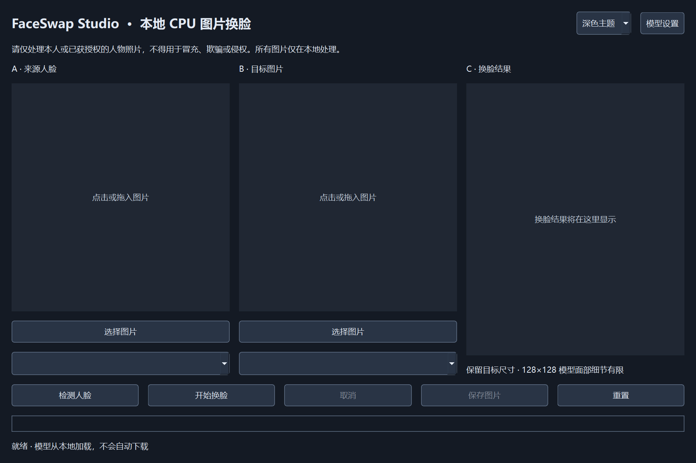

# FaceSwap Studio

Windows 11 本地 CPU 图片换脸桌面应用，Python 3.11 + PySide6。界面与完整推理适配代码已经实现；真实效果需要使用者配置已合法取得使用权限的模型。本仓库不包含模型、人像照片或换脸结果。



## 功能

- 简体中文三栏界面，支持深色/浅色、窗口缩放及 Qt 高 DPI。
- JPG/JPEG/PNG/WEBP/BMP 导入，点击选择与单图片拖入，Unicode 路径、EXIF 旋转、透明背景铺白。
- 后台自动检测，多人脸框与下拉选择，默认最高置信度；仅替换选定的目标人脸。
- 独立检测、识别和 inswapper_128 ONNX 模型，CPUExecutionProvider，加载后重复使用。
- 局部对齐、模型推理与 InsightFace 原生边缘羽化回贴。没有伪造的 AI 强度控件，没有高清无损承诺。
- 进度、耗时、取消、错误提示、防止并行任务、重置。
- 保存完整目标尺寸的 PNG/JPG/JPEG，覆盖确认与原子文件替换。
- 离线推理，不上传照片，无遥测，不持久缓存照片或 embedding。

## 系统要求与验证范围

Windows 11 x64、Python **3.11 x64**，建议 16GB RAM。不需要 NVIDIA GPU。CPU 单会话 4 个内部推理线程，检测输入 640×640，最大导入 2400 万像素。大图回贴可能占用数 GB 内存。

本次实际使用 Windows + CPython 3.11.13 环境。当前电脑缺少 C++ 编译器，`insightface==0.7.3` 源码构建出现：`Microsoft Visual C++ 14.0 or greater is required`。因此不声称完整后端依赖或真实换脸已通过验证。具体结果见 [验证记录](docs/VALIDATION.md)。GUI/ONNX Runtime 可以独立检查；应用遇到后端缺失会报错，绝不输出假换脸图。

直接依赖固定在 requirements.txt；已验证子集的传递依赖固定在 constraints-validated.txt；完整 InsightFace 依赖树尚未在本机验证。InsightFace 0.7.3 在官方 PyPI 提供源码发行包，需要本地编译。安装前准备 [Microsoft C++ Build Tools](https://visualstudio.microsoft.com/visual-cpp-build-tools/) 的“使用 C++ 的桌面开发”、MSVC x64 工具和 Windows SDK。不要从不明来源安装所谓预编译换脸 wheel。

## 一键安装与环境修复

推荐运行脚本，避免系统 Python 3.13 覆盖此项目的 Python 3.11 环境：

```powershell
# 修复/安装核心环境，先运行界面和单元测试
.\setup.ps1 -CoreOnly
# 安装官方 C++ Build Tools 的桌面 C++、MSVC x64、Windows SDK 后
.\setup.ps1
```

脚本优先使用本机已有 uv 缓存中的 Python 3.11 x64，或有效的现有 3.11 venv；找不到时明确报错。也可指定 `-Python311 'C:\对应安装目录\python.exe'`。旧的错误版本 venv 会移到项目内 `.venv-backup-日期时间`，不删除。备份只用于保留文件，不保证移动后的 venv 能直接运行。

如果终端提示符仍显示旧 `(.venv)`，先执行 `deactivate`（或打开新 PowerShell），再运行上述脚本。脚本始终显式调用新环境的 python.exe；运行应用和测试也可以直接调用 `.\.venv\Scripts\python.exe`。

完整安装会预检查 MSVC，缺失时保留已完成的核心环境并给出修复提示。源码构建阶段显式安装 NumPy 1.26.4 / Cython / setuptools / wheel，再使用 `--no-build-isolation`，使编译和运行使用同一份 NumPy。该模式由调用者准备构建依赖，参考 [pip 构建文档](https://pip.pypa.io/en/stable/cli/pip_install/#cmdoption-no-build-isolation)。

## 安装

以下手工流程必须先确认 `python --version` 是 Python **3.11**。本机默认 `python` 是 3.13，不要直接用它重建已有 `.venv`。优先使用上面的一键脚本；如果当前解释器已经是 3.11，执行：

```powershell
python -m venv .venv
.\.venv\Scripts\Activate.ps1
python -m pip install --upgrade pip
python -m pip install -r requirements.txt
```

全部安装后检查：

```powershell
python -m pip check
python -c "import insightface, onnxruntime, PySide6; print(onnxruntime.get_available_providers())"
```

本机已创建 `.venv`；不使用系统全局软件包。安装依赖需要联网，应用自身仅加载本地模型，推理可在断网环境运行。

如果 InsightFace 编译失败，安装上述 Build Tools，重新打开 PowerShell 后执行：

```powershell
.\setup.ps1
```

仅验证不依赖真实模型的 UI/单元测试时，可以安装以下组件；这不代表真实后端可用：

```powershell
python -m pip install PySide6==6.8.1 numpy==1.26.4 Pillow==11.0.0 opencv-python-headless==4.10.0.84 onnxruntime==1.20.1 onnx==1.17.0 pytest==8.3.4
```

## 运行与使用

```powershell
python main.py
# 或调用固定 .venv 的脚本
.\run.ps1
```

1. 首次启动缺少模型时自动弹出模型设置。可以取消设置继续查看界面，但不能执行换脸。
2. 选择检测、识别和换脸的本地 ONNX 文件。保存配置只做路径检查，模型类型和张量检查在后台首次加载执行。
3. 导入来源 A 和目标 B，等待各自自动检测；可以再次点击“检测人脸”。
4. 点击人脸框或下拉选择。多个检测结果按置信度排序，默认只选第一个。小脸、姿态或低置信度显示启发式警告，不能保证准确识别所有遮挡。
5. 点击“开始换脸”。取消在步骤之间生效，无法中断已经进入的单次 ONNX 推理；取消后丢弃推理结果，不改变输入文件。
6. 结果预览出现后保存。默认 PNG；JPEG 有损压缩会改变背景像素。PNG 保存模型回贴后的完整尺寸 BGR 数据。
7. 处理时关闭窗口会请求取消，并等待任务结束后允许再次关闭；不强制终止线程。

图片预览独立于原图，缩放预览不改变保存尺寸。目标和来源任一人脸选择变化、导入、模型设置或重置会使旧结果失效。图片保存过程中不提供取消，以免误导使用者对已经提交的文件状态的判断。

## 模型配置和授权

见 [模型说明](docs/MODELS.md)。默认配置 `config/model_config.json` 使用项目根目录下 `models/` 相对路径。设置保存到 `%LOCALAPPDATA%/FaceSwapStudio/model_config.json`，优先于仓库默认配置。打包后相对路径基于 EXE 所在目录，模型不放在 `_internal` 或 onefile 临时解压目录。

InsightFace 源代码与权重授权不同。官方说明其预训练模型存在非商用研究限制；不要将源代码许可证解释成权重商用授权。请自行向权利人取得适当许可，并仅处理已授权照片。参考 [InsightFace 官方仓库](https://github.com/deepinsight/insightface)。不下载、不再分发模型，不把人像结果或绝对路径提交 Git。

## 架构与目录

```text
main.py                     应用入口与隐私日志
src/ui/                     原生 Qt 界面、预览、模型设置
src/core/images.py          图片校验、读取、原子保存
src/core/models.py          ModelManager / FaceDetector / FaceSwapper / 后端协议
src/core/pipeline.py        FaceSwapPipeline、取消和选择校验
src/workers/task.py         QThread 与 Signal
src/utils/config.py         配置、资源路径和用户数据
config/model_config.json    不含机器路径的默认配置
models/                     用户本地模型目录（权重忽略）
assets/windows.manifest     DPI 与长路径声明
tests/                      mock 单元测试与可选真实集成测试
docs/                       模型与验证记录
run.ps1 / build_exe.ps1      venv 运行与打包
```

模型适配器通过 `DetectorBackend` / `SwapperBackend` 协议注入流程。替换模型时，应实现相应适配器并匹配识别 embedding 的语义、预处理和输出接口，不能只改一个文件名。

## 测试与开发

```powershell
python -m pytest -q
```

不需要真实权重的测试使用 mock，仅测试选择、异常、取消和线程流程，不用 mock 输出冒充产品效果。包含 Unicode/长路径、EXIF、输出失败保护、模型缺失/损坏、多人脸和来源/目标选择、连续处理、UI 自动检测/重置/线程投递等。

真实模型集成测试使用用户数据配置和两张已授权照片：

```powershell
$env:FSS_TEST_SOURCE = 'D:\private\source.png'
$env:FSS_TEST_TARGET = 'D:\private\target.png'
python -m pytest -q -m integration
```

缺少模型、后端或照片时明确 skipped；存在但损坏的模型应失败。测试输出仅保存到 pytest 私有临时目录，不提交 Git。

## EXE 打包

```powershell
python -m pip install -r requirements-build.txt
.\build_exe.ps1
# 可选 onefile（大模型仍外置）
.\build_exe.ps1 -OneFile
```

默认 onedir 输出 `dist/FaceSwapStudio/FaceSwapStudio.exe`、`_internal/`、`models/`、`config/`。Qt 插件由 PyInstaller 官方 hooks 收集，ORT DLL 显式收集。默认构建检查 InsightFace 可导入，不允许将缺少后端的包误认为完整版本。

`-AllowMissingBackend` 仅用于依赖故障时的界面诊断构建；不能用于发布完整换脸产品。模型目录只生成说明文件，不复制权重。EXE 不需要用户安装 Python。打包后的人工验收清单见 docs/VALIDATION.md。

## 常见故障

- **只有 Python 3.13**：安装 Python 3.11 x64，以对应解释器创建 venv，不复用不同版本的虚拟环境。
- **InsightFace 编译失败**：安装官方 MSVC Build Tools + Windows SDK，查看上面的精确修复命令。
- **PowerShell 不运行脚本**：可直接 `.\.venv\Scripts\python.exe main.py`；或依据本机策略仅为当前会话设置 `Set-ExecutionPolicy -Scope Process Bypass`。
- **模型缺失/无法加载**：确认路径、文件类型、SHA256 和 CPU 后端；不使用自动下载解决。
- **识别模型不兼容**：必须使用适配的 buffalo_l/w600k_r50；512 维只是张量维度，不证明模型来自兼容训练体系。
- **人脸未检测或效果差**：使用清晰、较大、正面且无遮挡的脸。检测和 128×128 换脸都有质量限制，不保证角度/光照/肤色完全一致。
- **保存失败**：检查目录存在、可写、磁盘空间和文件占用；失败保留原文件。没有隐式创建用户指定目录。
- **长路径访问失败**：EXE manifest 启用 longPathAware；Python 启动受系统长路径策略影响。测试覆盖扩展路径前缀，Windows 文件对话框仍可能受系统限制。
- **配置损坏**：备份后修复用户数据目录 JSON，或移走该 JSON 重新配置。

日志位于 `%LOCALAPPDATA%/FaceSwapStudio/studio.log`，滚动限额 1MB × 3，不包含照片、完整特征向量或原始模型异常消息。开发诊断时请勿添加人像二进制和 embedding 日志。

## 后续扩展

替换为有明确商业许可的更高分辨率模型；增加经验证的融合/颜色校正适配器、GPU 可选提供程序、批量队列与更全面的真实模型回归。上述功能不包含在当前版本中。
